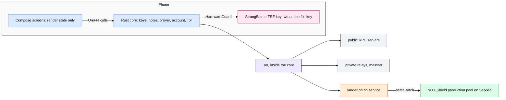
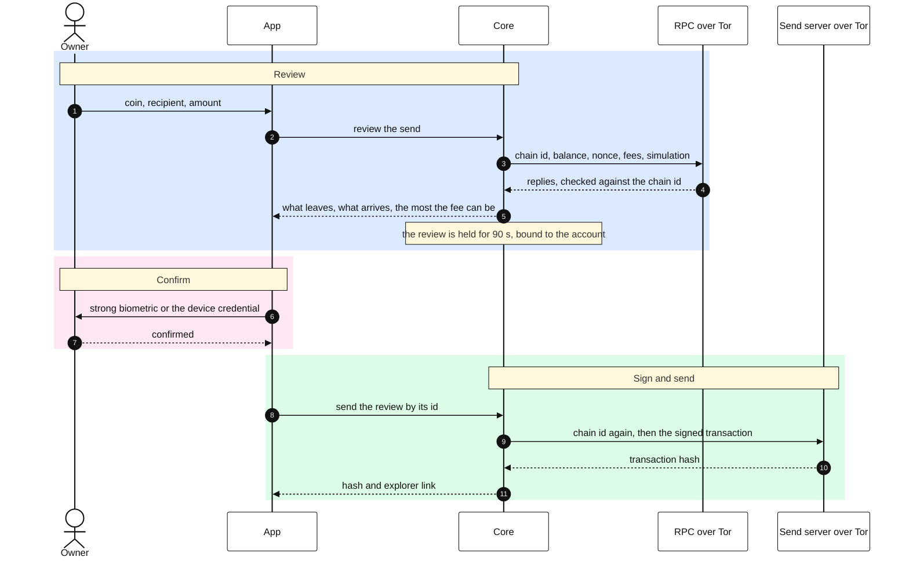

# NØNOS Wallet for Android

The Android app of NØNOS Wallet, a phone wallet for NOX Shield: private transfers on Ethereum, proved on the phone and verified on chain.

To try it, [TESTING.md](TESTING.md) takes you from installing to a private transfer and a
withdrawal, step by step.

> [!WARNING]
> The shield runs on Sepolia only, and its tokens have no value. The public account moves real
> funds on Ethereum mainnet. Nothing is audited: not the app, not the core, not the pool. The
> proving time on a phone is not published, because it needs the median of three runs whose
> proofs the live verifier accepts. There is no Play Store or F-Droid listing yet. What the core checks and what it does not is in
> [its security status](https://github.com/NON-OS/shield-core/blob/main/docs/20-security-status.md).

| Fact | Value | Source |
|---|---|---|
| Proof system | a STARK over the Goldilocks field with FRI, hash-based, no trusted setup, proved on the phone by the core | [the core README](https://github.com/NON-OS/shield-core) |
| Pool | the NOX Shield production pool on Sepolia, `0xaEe51E82965Ec1DeD870F3f4c248Ad4AdDc3e1cb` | `core/src/net/pools.rs` in the core |
| Proof size | 94,760 to 95,752 bytes for the pinned 37-limb vectors, a 40-byte header and the proof | `core/tests/prod_vectors.rs` in the core |
| Verifier cost | 3,934,660 gas for the first settlement on the production pool | settlement [`0x93bd48ea…ec0d`](https://sepolia.etherscan.io/tx/0x93bd48eab8253ce497afbdc3fca7071a1d24a73599c866bd599101e301d2ec0d), block 11,817,581 |
| Amounts | standard sizes only: 1,000 to 5,000,000 NOX, 0.01 to about 18.44 ETH | `AmountPolicy` on chain |
| Fee | the protocol part, 400 NOX or 0.0005 ETH for a private transfer and 0.50% of a withdrawal, plus one rung of the gas ladder. Read from the pool and checked by it before any proving, never typed. A transfer shows its fee from the lowest rung, 2,400 NOX or 0.003 ETH | `core/src/net/fee_schedule.rs` in the core, `ui/screens/SpendTicketText.kt` |
| Trust model | every decision about money is taken in the core. The app holds the window, the keystore key and the screens | [02-app.md](docs/02-app.md) |
| Networks | the shield on Sepolia. The public account on Ethereum mainnet and Sepolia. Swaps on mainnet only | `core/src/evm/network.rs` in the core |
| Landers | five onion services, tried in order and given 20 seconds each, reached over the Tor client inside the core, each checked for the production pool first ([the list](https://github.com/NON-OS/shield-core/blob/main/docs/03-transport.md)). Every proof pays whoever lands it, so the owner can land a spend from the public account instead | `core/src/net/relay` in the core, `ui/state/SelfSettle.kt` |

This repository holds presentation and platform integration. The prover, the note store, the key
custody, the Ethereum account and the network client live in the Rust core,
[shield-core](https://github.com/NON-OS/shield-core), and every decision about money is taken there. The claims about the
core, with their evidence, are in its README.

## How it fits together

The app, the core inside it, and what the core reaches over Tor. One colour per actor.



A public send, from the review to the hash. Nothing is signed before the core has worked out the
send in full and the platform has confirmed the owner.



| Doc | What it covers |
|---|---|
| [01-setup.md](docs/01-setup.md) | the user guide: making a wallet and using each screen |
| [02-app.md](docs/02-app.md) | what the app owns and trusts, and what an attacker can do |
| [03-reproduce.md](docs/03-reproduce.md) | the pinned toolchain, and rebuilding a release to its hash |
| [04-release.md](docs/04-release.md) | how a release is signed with a key no runner holds, and how to check it |
| [05-install.md](docs/05-install.md) | installing from GitHub Releases, from the site or with Obtainium, with the SHA-256 check |
| [06-play.md](docs/06-play.md) | a Play Console listing as an organization |
| [07-hardening.md](docs/07-hardening.md) | every protection, where it lives and what checks it |
| [08-measure.md](docs/08-measure.md) | timing a proof and reading its peak memory on a phone |
| [09-tutorial.md](docs/09-tutorial.md) | the script and shot list of the tutorial video |
| [10-messages.md](docs/10-messages.md) | what each message on screen means |
| [11-build.md](docs/11-build.md) | building and checking on a shared server, in a folder of your own at the lowest priority |

## What works today

| What | Evidence |
|---|---|
| Create or restore from recovery words, sealed under a StrongBox or TEE key that opens only after the owner is confirmed | `core/StrongBoxGuard.kt`, `core/DeviceGuard.kt`, `ui/state/Guarded.kt` |
| The public account: ETH, NOX and USDC on Ethereum and on Sepolia, send and receive | `ui/state/Account.kt`. Every send is reviewed by the core, then confirmed with a strong biometric or the device credential |
| Swaps between ETH, NOX and USDC on Ethereum mainnet | `ui/state/Swapping.kt`, `ui/screens/SwapReviewView.kt` |
| The shield on Sepolia: deposit signed from the public account, receive at a `nox1` address, send privately, withdraw, take back | `ui/state/Money.kt`, `ui/state/TakeBack.kt` |
| A proved spend handed to the lander over Tor and followed until it settles, or landed from the public account by its owner | `ui/state/Relaying.kt`, `ui/state/SelfSettle.kt`, `ui/screens/SpendTicketView.kt` |
| The fee of a send said before proving, from the pool, and checked with the pool before any proving time is spent | `ui/screens/SpendTicketText.kt`, `fee_schedule.rs` in the core |
| A spend waits for 20 more notes and about 6 hours after a deposit, with a privacy meter that counts both down, and a typed EARLY to skip it | `ui/screens/PrivacyMeter.kt`, `ui/screens/EarlyConfirm.kt` |
| Each withdrawal is filled in with an unused address of the same words, and a used address is warned about | `ui/screens/WithdrawNote.kt`, `ui/screens/SpendForm.kt` |
| Receive opens on the private `nox1` address where the shield runs | `ui/screens/HomeActions.kt` |
| Restore from recovery words of any standard length, or from a private key | `ui/screens/RestoreScreen.kt` |
| Several accounts from one phrase, found again after a restore, each named on every review | `ui/state/Accounts.kt`, `ui/screens/AccountsPanel.kt`, `ui/screens/FromNote.kt` |
| The words, the account key and the view keys shown only after the owner is confirmed, and view-only accounts from a view key | `ui/state/Keys.kt`, `ui/screens/KeysPanel.kt`, `ui/screens/WatchedSection.kt` |
| A proof timed on the phone, shown in seconds | `ui/screens/BenchPlate.kt`, `format_seconds` in the core |
| Every core failure has one sentence, the same as on iOS | `app/src/test/.../ui/state/FailuresTest.kt`, run on every build |
| The package carries the core for both ABIs, with every binding symbol | `scripts/check-package.sh`, run on every release build |
| Every native library on 16 KB pages, as Android 15 and Play require | `scripts/align-release.sh`, run on every release build |
| A release signed off the runner, and checked to be the reproduced build plus a signature | `scripts/sign-release.sh`, `scripts/check-release.sh` |

Paths under `ui/` and `core/` are relative to `app/src/main/kotlin/systems/nonos/shield`.

## How to verify it

Every release carries the APK and its SHA-256. Check the hash before installing:

```sh
sha256sum -c NONOS-v1.2.3.apk.sha256
```

Releases are published on the public repository
[NON-OS/shield-android](https://github.com/NON-OS/shield-android), whose README is the install
guide. The build server builds each tag twice from clean and compares the two, nothing is built on
GitHub, and the release key signs the result on its own machine, where
`scripts/check-release.sh` shows the signed APK is the published build plus a signature and nothing
else ([04-release.md](docs/04-release.md)). Anybody with the source can rebuild a tag to its hash
([03-reproduce.md](docs/03-reproduce.md)).

## How to build it

| Tool | Version | Where it is pinned |
|---|---|---|
| The core | the commit in `core.lock` | `scripts/build-core.sh` refuses any other |
| Rust | 1.91.1 | `rust-toolchain.toml` in the core |
| JDK | Temurin 17 | `.github/workflows/check.yml` |
| Android NDK | the version in `assets/core.txt` of a release | read from the SDK by `scripts/build-core.sh` |
| Build tools | 36.0.0 or later, for `zipalign -P 16` | `scripts/align-release.sh` |
| cargo-ndk | 4.1.2 | `.github/actions/core` |
| Android | API 28 or later, target 36 | `app/build.gradle.kts` |

```sh
scripts/build-core.sh               # the core for arm64-v8a and x86_64, and the Kotlin bindings
./gradlew :app:assembleRelease
./gradlew ktlintCheck detekt :app:testDebugUnitTest
scripts/align-release.sh app/build/outputs/apk/release/app-release-unsigned.apk aligned.apk
```

32-bit ARM is not built: a Goldilocks multiply folds a 128-bit product, and the prover is not
shipped where that is slow.

## Limits

- The shield runs on Sepolia only. Swaps run on Ethereum mainnet only.
- A transfer proved on an Android phone and settled on the production pool is not recorded here
  yet.
- Notes on older pools stay there. Moving them is a public withdrawal to a fresh address and a
  new deposit, and the app does not do it yet.
- Nothing here has been audited.
- There is no Play Store or F-Droid listing yet. The APK is installed by hand or with Obtainium,
  from the public repository.
- The proving time on a phone is not published yet: it must be the median of three runs, each
  proof accepted by the live verifier, and the core has no kit for the production verifier yet.
- A send shows its fee from the lowest rung of the gas ladder. The full fee is checked with the
  pool before proving, and the screen does not show it to the unit yet.

## Security and privacy

- `FLAG_SECURE` is set before the first frame, so no balance, address or recovery word reaches a
  screenshot, the recents thumbnail or a recorder.
- Three install-time permissions: `INTERNET`, `USE_BIOMETRIC`, and `USE_FINGERPRINT` on API 28
  only. No contacts, storage, location, identifiers or advertising ID.
- No Google Play Services on any path. The app installs and runs without a Google account.
- There is no analytics, no crash reporter and no attribution SDK. The third-party libraries are
  the foreign function interface the core is reached through and ZXing, which draws the receive QR
  code on the device. Every component and its licence is on the licences screen.
- Backup and device transfer are excluded for the whole data directory of the app, so the sealed
  vault never reaches a cloud.
- Nothing is written to the log in release builds. The calls are stripped, not filtered, those of
  the libraries included, and the build refuses a log call in the source.
- Every connection goes through the Tor client in the core. The app itself opens none, and its
  network security config refuses cleartext and every certificate a user installed.
- Every protection and what checks it is in [07-hardening.md](docs/07-hardening.md).
- A copied address or hash is marked sensitive, so keyboards and clipboard previews do not show
  it, and it is cleared after a minute.
- Leaving the app locks the wallet. There are no notifications, so no amount can appear on a lock
  screen.

Report a flaw to ek@nonos.systems or team@nonos.systems.

## Layout

| Path | What is in it |
|---|---|
| `app/src/main/kotlin/.../core` | The keystore guard, the wallet factory, the clipboard, the system prompt |
| `app/src/main/kotlin/.../ui/state` | One immutable state, one dispatcher, the actions |
| `app/src/main/kotlin/.../ui/screens` | The screens, which render state and nothing else |
| `scripts/build-core.sh` | Cross compiles the core and generates the bindings |

The design is Etna, after the volcano of Sicily: each section opens with a recoloured photograph of
Etna in eruption. The photographs are by gnuckx under CC BY 2.0, credited in Settings, About,
Acknowledgements.

## Licence

AGPL-3.0-or-later.
